  <picture>
    <source media="(prefers-color-scheme: dark)" srcset="./dark.svg">
    <source media="(prefers-color-scheme: light)" srcset="./light.svg">
    
  </picture>

<h1 align="center">Hi, I'm Nishant Sain 👋</h1>

  <strong>BTech CSE (AI &amp; ML) Student · Software Builder · IoT Enthusiast</strong>

  I enjoy turning ideas into practical software and connected systems — from web products and developer tools to AI/ML learning projects and IoT prototypes.

👨‍💻 About Me
- 🎓 Studying BTech in Computer Science & Engineering (AI/ML) at K.R. Mangalam University.
- 🧩 Interested in software development, AI/ML, web technologies, and IoT.
- 🛠️ Building and experimenting with real-world projects that combine software, hardware, and product thinking.
- 🌱 Focused on strengthening my engineering fundamentals and learning by building.
🚀 Featured Work
Smart Parking — AI + IoT Capstone
A smart parking prototype combining an ESP32, IR-based slot detection, lighting automation, an LCD interface, and a web-based experience.
Pixalera / Pixum
Product and web-development work exploring SaaS experiences, social-platform workflows, and desktop productivity tools.
Developer Portfolio
A personal portfolio project showcasing my learning and development work.
Project descriptions are intentionally concise. Add repository links below when the corresponding repositories are public and ready to share.

🧰 Technologies & Tools

  
  
  
  
  
  
  
  

📊 GitHub Activity

  
  

🐍 Contribution Snake
The Snake image below becomes available after setting up the separate github-snake repository and its GitHub Actions workflow.

  <picture>
    <source media="(prefers-color-scheme: dark)" srcset="https://raw.githubusercontent.com/nishantsain/github-snake/output/github-snake-dark.svg">
    <source media="(prefers-color-scheme: light)" srcset="https://raw.githubusercontent.com/nishantsain/github-snake/output/github-snake.svg">
    
  </picture>

Snake setup: Create a public repository named github-snake, add the workflow from your contribution-snake setup guide at .github/workflows/snake.yml, replace YOUR_GITHUB_USERNAME with nishantsain, enable Read and write permissions under Settings → Actions → General, and run the workflow once. It publishes the SVG files to the output branch. The README snippet above then loads the dark or light version automatically.
🤝 Connect

  
  
  

  “Build with curiosity. Improve with every iteration.”

